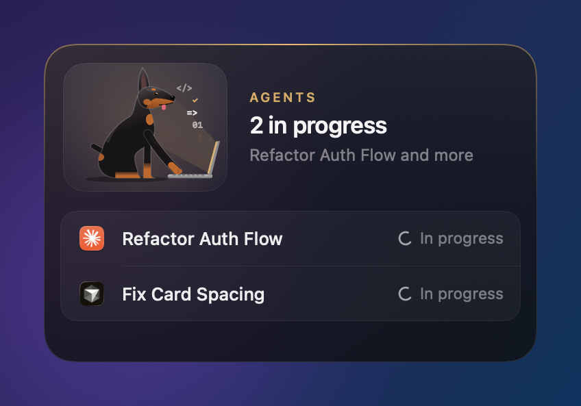
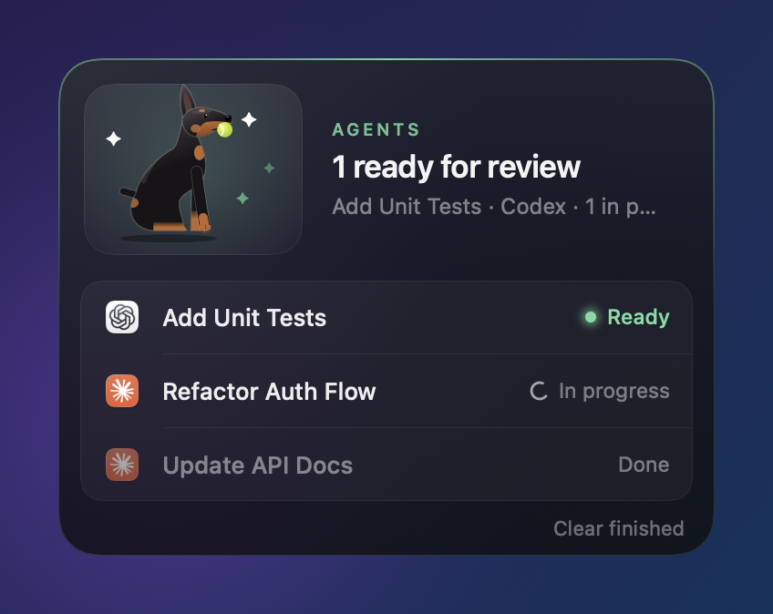
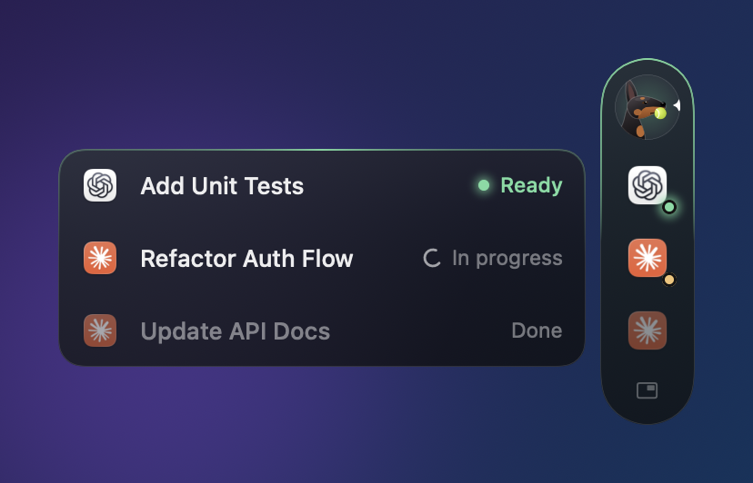

# Agent Board

A small floating board for your Mac that shows which of your AI coding agents are working, which are done, and which are waiting on you. Click a task and you land in the exact chat or terminal it's running in.

Built for people who fire off prompts in five places at once and then forget which ones finished.

<p align="center">
  
  
</p>

A Doberman lives in the corner and acts out the mood: typing hard at a laptop while agents work, sitting up with a ball when something's ready, tilting its head when an agent needs your approval, and napping when everything's clear.

## What it tracks

| Tool | How | Click takes you to |
|---|---|---|
| **Claude Code** (any terminal) | Claude Code hooks | The exact Terminal or iTerm tab, the Cursor terminal tab, or the Herdr pane |
| **Cursor** agent chats | Cursor hooks | The Cursor window for that project |
| **Codex** (desktop app and CLI) | Reads Codex's local session logs, plus its `notify` hook | The exact Codex thread |
| **Claude desktop app** | Reads the app's window through macOS Accessibility (the Stop button means it's writing) | That chat, opened in the app |
| **Herdr** panes | Records the Herdr pane each agent runs in | That pane, via `herdr agent focus` |

Each task shows the app icon, a three-word summary of what you asked, and its status: **In progress**, **Ready**, **Approve** or **Done**. You get a chime when something finishes.

**One row per conversation window.** Keep chatting in the same terminal tab, Herdr pane, Codex thread or Cursor chat and its row just updates, even after `/clear`. Background `claude -p` runs (scripts, pipelines, subagents) never get rows or overwrite yours.

## Two views

Hover the card and click the sidebar icon to switch to a slim **side rail** that sits on the right edge of your screen. Hover the rail and the task list slides out to the left. The small card icon at the bottom of the rail switches back.

<p align="center"></p>

The ✕ hides the board. It slides back in when you send a new prompt anywhere, or when something finishes. The paw in the menu bar brings it back any time.

## Install

You need **macOS 15 (Sequoia) or newer**.

### Option 1: download (no developer tools needed)

1. Download `AgentBoard.zip` from the [latest release](../../releases/latest) and unzip it.
2. Open Terminal, then run:
   ```bash
   cd ~/Downloads/AgentBoard
   ./install.sh
   ```

### Option 2: build from source

```bash
xcode-select --install   # only if you don't have the command line tools yet
git clone https://github.com/achal-walia-1/agent-board.git
cd agent-board
./install.sh
```

The installer is safe to run again. It backs up every config file it touches (`*.agent-board-bak-<date>`) and only adds its own entries.

### After installing (one time)

1. **Claude desktop app:** System Settings → Privacy & Security → Accessibility → turn on **Agent Board Helper**.
2. **Cursor:** run **Developer: Reload Window** once in each open window, so clicks can open the exact terminal tab.
3. **Restart** any Claude Code, Codex or Cursor sessions that were already open, so they pick up the hooks.
4. The first time you click a Terminal task, macOS asks whether Agent Board may control Terminal. Click **Allow**.

## Privacy

Everything stays on your Mac. Task state lives in `~/.agent-board/state.json`.

The one exception: the three-word titles are written by Claude Haiku through **your own** `claude` CLI, so the first ~700 characters of each prompt go to Anthropic under your account (the same place your Claude Code prompts already go). To turn that off and use simple keyword titles instead:

```bash
touch ~/.agent-board/no-ai-titles
```

If you don't have the `claude` CLI installed, it uses keyword titles automatically.

## Uninstall

```bash
./uninstall.sh
```

It stops Agent Board, deletes the apps, and takes its hooks back out of Claude Code, Cursor and Codex, restoring whatever Codex `notify` program you had before. Your other settings are left alone.

## Troubleshooting

- **A click doesn't land in the right place:** every click is logged in `~/.agent-board/jump.log`, step by step.
- **A session isn't showing up:** sessions that were already open when you installed need a restart to load the hooks.
- **The Claude desktop app isn't tracked:** check the Accessibility permission above. It only sees the chat that's open on screen.
- **Nothing shows at all:** `launchctl list | grep agentboard` should list three services. Re-run `./install.sh`.

## How it works

- `bin/agent-board-event` is called by each tool's hooks and writes `~/.agent-board/state.json`.
- `bin/agent-board-watch` follows Codex's session logs in `~/.codex/sessions`.
- `AgentBoardAX.swift` is the Accessibility helper for the Claude desktop app. It's a separate app so its permission survives updates.
- `AgentBoard.swift` is the board itself (SwiftUI). The Doberman is drawn in code, no image assets.
- `cursor-extension/` is a tiny Cursor extension that brings the right terminal tab to the front.
- `design/` has the alternative layouts that were explored, rendered from `design/mockups.swift`.

Run `swiftc -O -o /tmp/ab AgentBoard.swift -framework SwiftUI -framework AppKit && /tmp/ab --snapshot <dir>` to render previews of every state without touching your screen.

## License

MIT. See [LICENSE](LICENSE).
